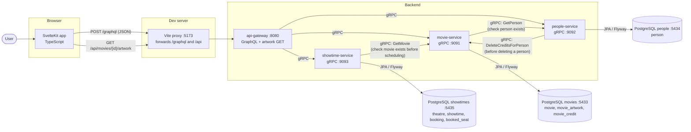
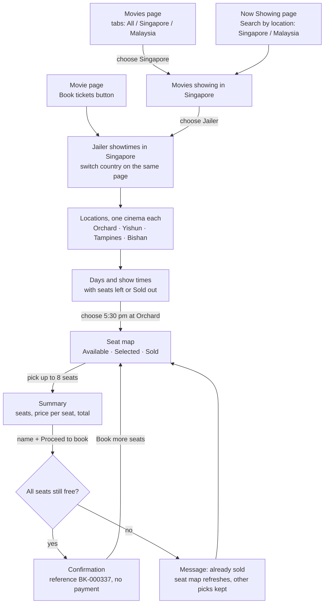
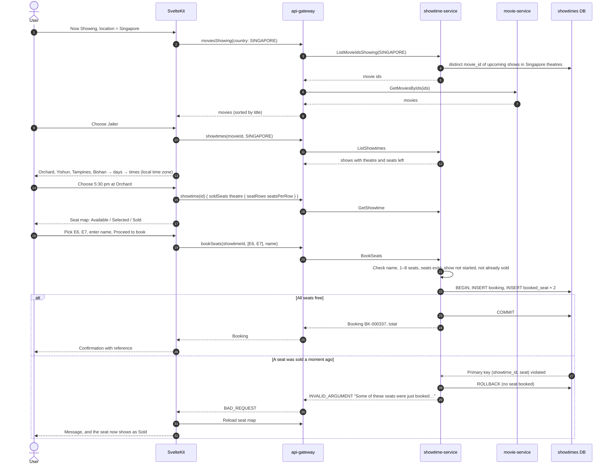

# Movie Management System

A web app for managing movies, their artwork, and their cast and creators.

- **Frontend:** SvelteKit (Svelte 5) + TypeScript
- **Backend:** four Kotlin + Spring Boot services
- **Frontend → backend:** GraphQL
- **Service → service:** gRPC
- **Storage:** PostgreSQL, one database per service

## Features

- List movies with artwork, with search by title and pagination.
- Location tabs on the Movies page: All, Singapore, Malaysia (`/?showing=SINGAPORE`) list the movies showing
  there, combined with search and paging. Cards then open the movie's showtimes in that country.
- Add, edit and delete movies.
- Upload movie artwork (JPEG, PNG, GIF or WebP, up to 5 MB) with a real upload progress bar.
- List cast and creators, filter by role, search by name.
- Add, edit and delete cast and creators.
- Link people to movies. A movie page shows its cast and creators; a person page shows their movies.
- Search movies, cast and creators together from the header search box.
- Feedback everywhere: loading skeletons, "Searching…" status, saving spinners, upload progress,
  success and error messages, and "Try again" buttons when a request fails.
- **Now Showing / search by location** (Singapore or Malaysia): lists the movies showing there. Choosing a movie
  lists each location (Orchard, Yishun, Tampines, Bishan… one cinema each) with show times per day and seats left.
- **Seat booking:** choosing a time opens the seat map with Available, Selected and Sold seats in different colours.
  Choosing seats shows the price and total; "Proceed to book" books them (sample: no payment) and returns a
  reference like `BK-000042`. Up to 8 seats per booking. A seat can never be sold twice, even when two people
  book it at the same moment.
- Responsive layout for phone and desktop, with light and dark themes.

## Architecture

```
Browser (SvelteKit SPA)
   │  GraphQL  POST /graphql
   │  HTTP     GET  /api/movies/{id}/artwork   (image bytes for  tags)
   ▼
api-gateway :8080 ──gRPC──▶ movie-service    :9091 ──▶ PostgreSQL "movies"    :5433
                  ├─gRPC──▶ people-service   :9092 ──▶ PostgreSQL "people"    :5434
                  └─gRPC──▶ showtime-service :9093 ──▶ PostgreSQL "showtimes" :5435

movie-service  ──gRPC──▶ people-service   (check a person exists before crediting them)
people-service ──gRPC──▶ movie-service    (remove a person's credits before deleting them)
showtime-service ──gRPC──▶ movie-service  (check a movie exists before scheduling a show)
```

### System flow



### User journey: search by location and book seats



### Sequence: booking seats



More diagrams (request layers, seat states, artwork upload, credits, deleting a person):
[docs/diagrams.md](docs/diagrams.md). GitLab and GitHub draw Mermaid diagrams automatically.

| Module | Role |
|---|---|
| `backend/proto-contracts` | `.proto` files; Gradle generates the Java gRPC stubs used by all services. |
| `backend/api-gateway` | GraphQL API for the frontend. No database. Calls the services over gRPC and turns gRPC errors into user-friendly GraphQL errors. |
| `backend/movie-service` | Owns movies, artwork and credits (movie ↔ person links). gRPC server. |
| `backend/people-service` | Owns cast and creators. gRPC server. |
| `backend/showtime-service` | Owns theatres, shows and seat bookings. gRPC server. |
| `backend/integration-tests` | Starts all services together for end-to-end tests. |
| `scripts/seed_showtimes.py` | Schedules sample shows and sells a few seats (needs the services running). |
| `frontend` | SvelteKit single-page app. |

Design notes:

- **Artwork upload goes through GraphQL.** The file is sent as base64 in the `uploadArtwork` mutation, and the
  browser reports real upload progress with `XMLHttpRequest`. Base64 adds about 33% to the size, which is fine for a 5 MB limit.
- **Artwork download is a plain HTTP GET.** An `` tag needs a URL. The URL contains a version
  (`?v=<upload time>`), so browsers cache each image for a year and still see new uploads at once.
- **Uploaded files are checked by their bytes, not by the type the browser claims.** Only real JPEG/PNG/GIF/WebP
  images are stored, so nobody can upload an HTML file and have it served from our domain.
- **Each service owns its data.** `movie_credit.person_id` points into another database, so there is no foreign key.
  Consistency is kept by gRPC calls: credits are checked on add and removed when a person is deleted.
- **Validation lives in the services.** The frontend repeats the same rules for instant feedback only.
- **Location tabs use two services.** `movies(showingIn: SINGAPORE)`: the gateway asks showtime-service which
  movies are showing there, then movie-service searches and pages only those ids. Nothing showing returns an empty
  page directly (not "all movies").
- **No double booking.** `booked_seat` has primary key `(showtime_id, seat)`. Seats are inserted with a plain
  `INSERT`, so a seat that is already sold makes the database refuse it, and the whole booking is rolled back.
  The integration tests send four bookings for the same seat at once: exactly one succeeds.
- **Times are stored in UTC** and shown in the theatre's time zone (Asia/Singapore, Asia/Kuala_Lumpur), so a
  viewer abroad still sees the local show time. Prices are whole cents to avoid rounding errors.

## Prerequisites

- JDK 17 or newer (the Gradle build uses a Java 17 toolchain)
- Node.js 20 or newer
- Docker (for PostgreSQL)

## Setup and run

Start each part in its own terminal, from the project root.

1. Start the databases:

   ```bash
   docker compose -f infrastructure/docker-compose.yml up -d
   ```

2. Start the backend services. Flyway creates the tables on first start.

   ```bash
   cd backend && ./gradlew :movie-service:bootRun
   ```

   ```bash
   cd backend && ./gradlew :people-service:bootRun
   ```

   ```bash
   cd backend && ./gradlew :showtime-service:bootRun
   ```

   ```bash
   cd backend && ./gradlew :api-gateway:bootRun
   ```

3. Start the frontend:

   ```bash
   cd frontend && npm install && npm run dev
   ```

4. Add sample movies and shows for Now Showing (theatres are created by the database migration; without this step Now Showing is empty):

   ```bash
   python3 scripts/seed_showtimes.py
   ```

5. Open http://localhost:5173. The dev server forwards `/graphql` and `/api` to the gateway on port 8080.

GraphiQL, an in-browser GraphQL console, is at http://localhost:8080/graphiql.

### Configuration

Defaults work for local development. Override them with environment variables:

| Variable | Default | Used by |
|---|---|---|
| `MOVIE_DB_URL`, `MOVIE_DB_USER`, `MOVIE_DB_PASSWORD` | `jdbc:postgresql://localhost:5433/movies`, `movies`, `movies_dev` | movie-service |
| `PEOPLE_DB_URL`, `PEOPLE_DB_USER`, `PEOPLE_DB_PASSWORD` | `jdbc:postgresql://localhost:5434/people`, `people`, `people_dev` | people-service |
| `MOVIE_GRPC_HOST`, `MOVIE_GRPC_PORT` | `localhost`, `9091` | all |
| `PEOPLE_GRPC_HOST`, `PEOPLE_GRPC_PORT` | `localhost`, `9092` | all |
| `SHOWTIME_DB_URL`, `SHOWTIME_DB_USER`, `SHOWTIME_DB_PASSWORD` | `jdbc:postgresql://localhost:5435/showtimes`, `showtimes`, `showtimes_dev` | showtime-service |
| `SHOWTIME_GRPC_HOST`, `SHOWTIME_GRPC_PORT` | `localhost`, `9093` | showtime-service, api-gateway |
| `GATEWAY_PORT` | `8080` | api-gateway |
| `GATEWAY_URL` | `http://localhost:8080` | frontend dev server |

## Tests

```bash
cd backend && ./gradlew test
```

The backend tests include integration tests that start PostgreSQL in Docker (Testcontainers), so Docker must be running.

```bash
cd frontend && npm test
```

- **movie-service:** business rules (validation limits, paging, artwork size and type, credits, people-service
  failures), image type detection, and the gRPC endpoint run in memory (message mapping, status codes, no leaked error details).
- **people-service:** business rules (validation, role filter, batch lookup order, deleting credits first, keeping the
  person when movie-service is down) and the gRPC endpoint.
- **showtime-service:** booking rules (name, 1–8 seats, duplicates, seats outside the theatre, already sold, sold
  at the same moment, started shows), scheduling rules (price range, past times, unknown theatre or movie), seat labels.
- **api-gateway:** real GraphQL requests against the schema with mocked gRPC stubs (paging defaults, artwork URLs,
  one batched people-service call per response, base64 and id errors, every gRPC status mapping) and the artwork endpoint.
- **frontend:** form validation, upload checks, GraphQL response and error parsing, debounce and URL helpers.

Integration tests (real PostgreSQL in Docker, real Flyway migrations):

- **Repositories** (`MovieRepositoryIntegrationTest`, `PersonRepositoryIntegrationTest`): case-insensitive search,
  `%` and `_` matched literally, paging, the id filter used by the location tabs, the role filter, credits, deleting a person's credits, a movie's
  artwork and credits deleted with it, and the database constraints. `ddl-auto=validate` also checks the entities match the tables.
- **Full stack** (`backend/integration-tests`): starts all three services in one JVM with real gRPC between them and
  two databases, then sends GraphQL requests over HTTP. Covers credits across both services, unknown people, search, artwork upload and download, rejected files, validation errors, deleting a person or a movie across databases,
  keeping a person when movie-service is down, search by location, scheduling a show for an unknown movie,
  booking and re-booking sold seats, and four simultaneous bookings of one seat (exactly one wins).

Edge cases covered include blank and whitespace-only text, exact length limits (and one character over), year bounds,
empty and oversized files, files pretending to be images, invalid ids, duplicate credits, unknown people,
unavailable services, and non-JSON error pages.

## How AI tools were used

See [docs/ai-usage.md](docs/ai-usage.md).
