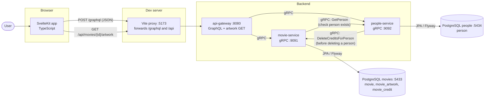
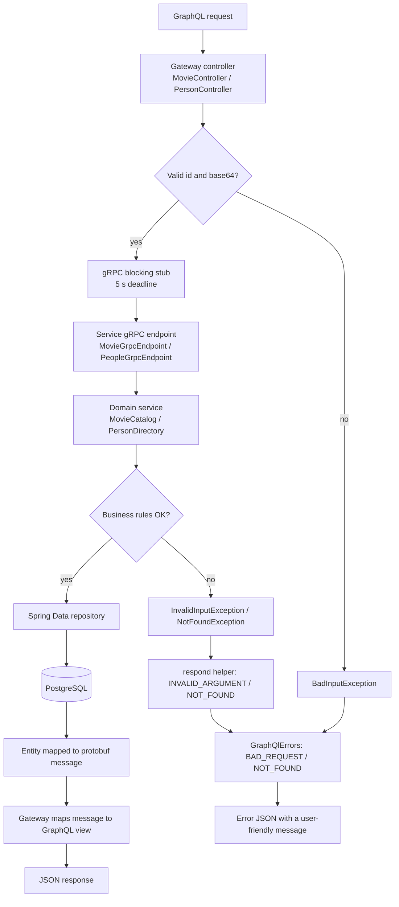
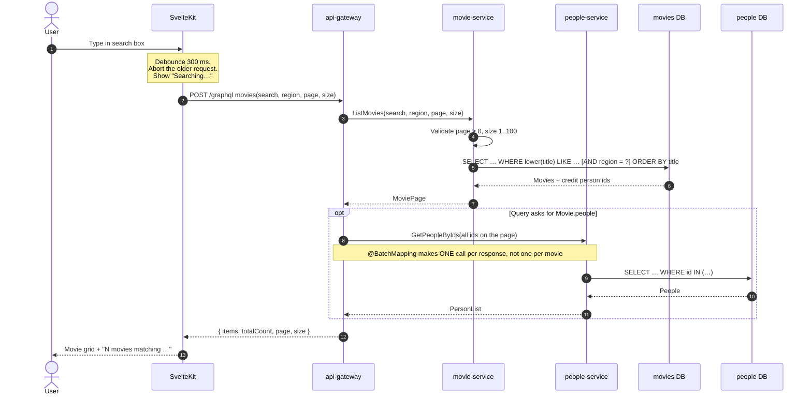
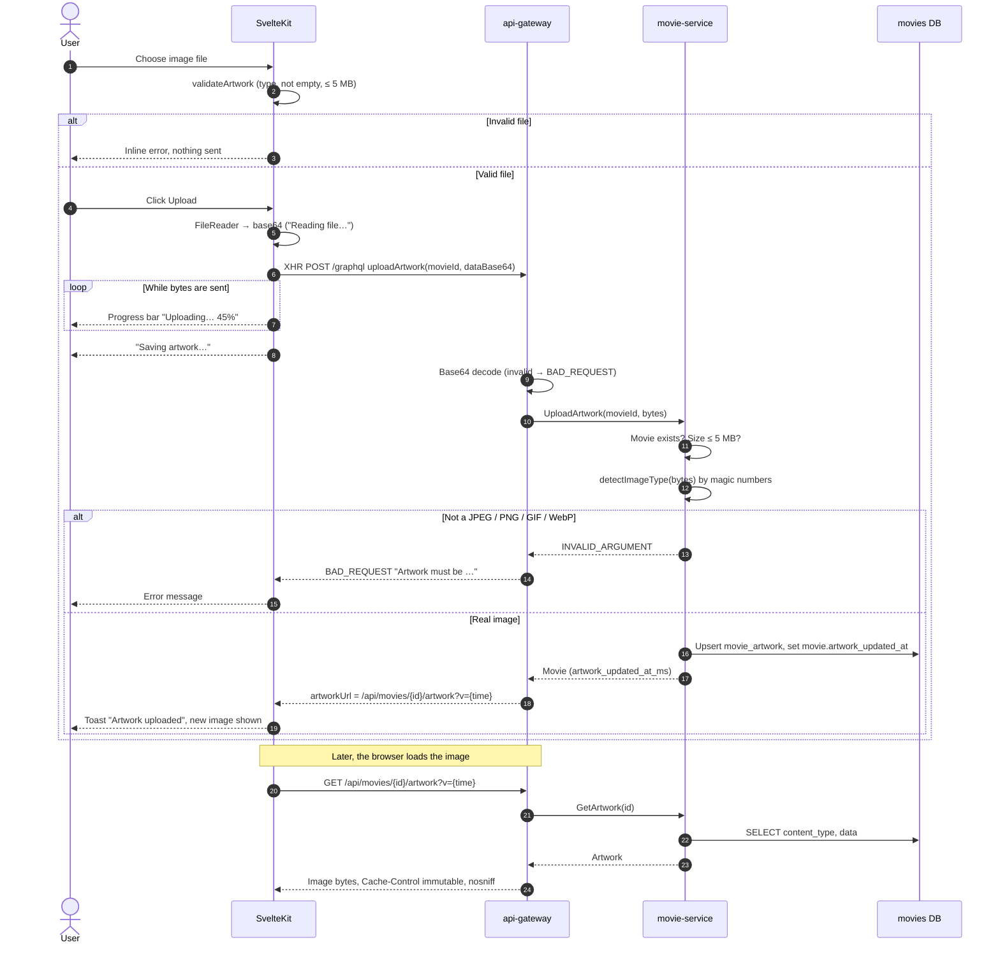
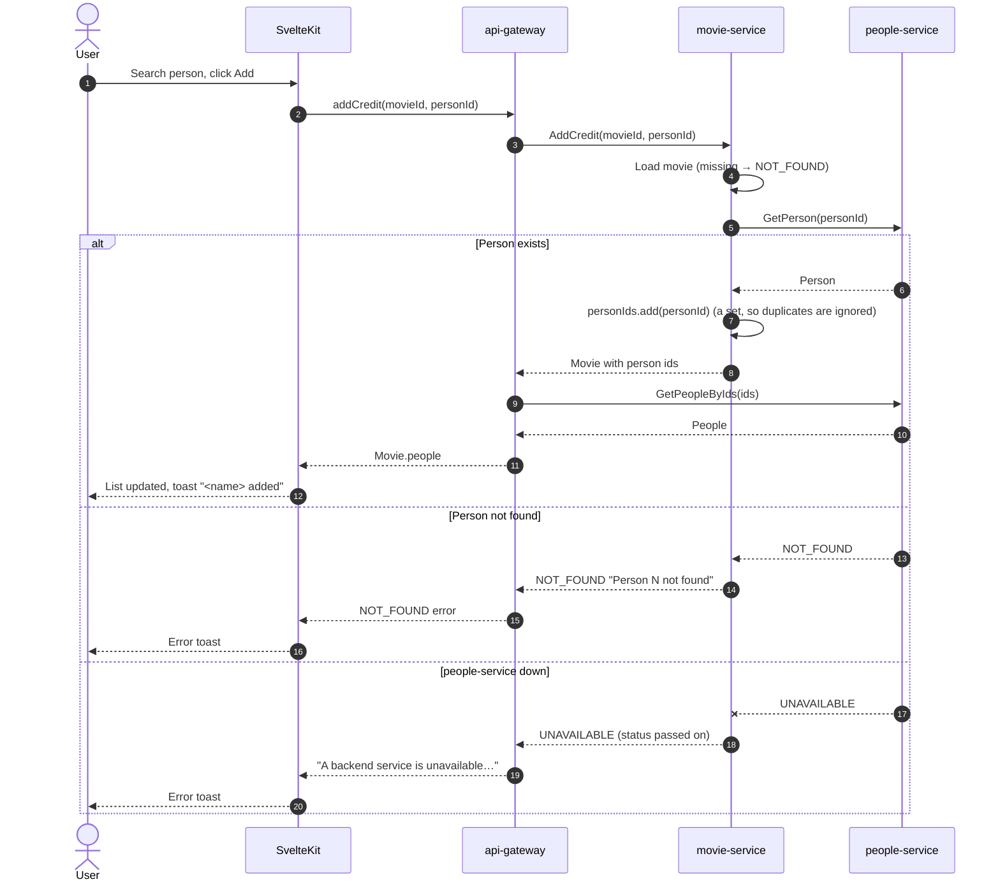
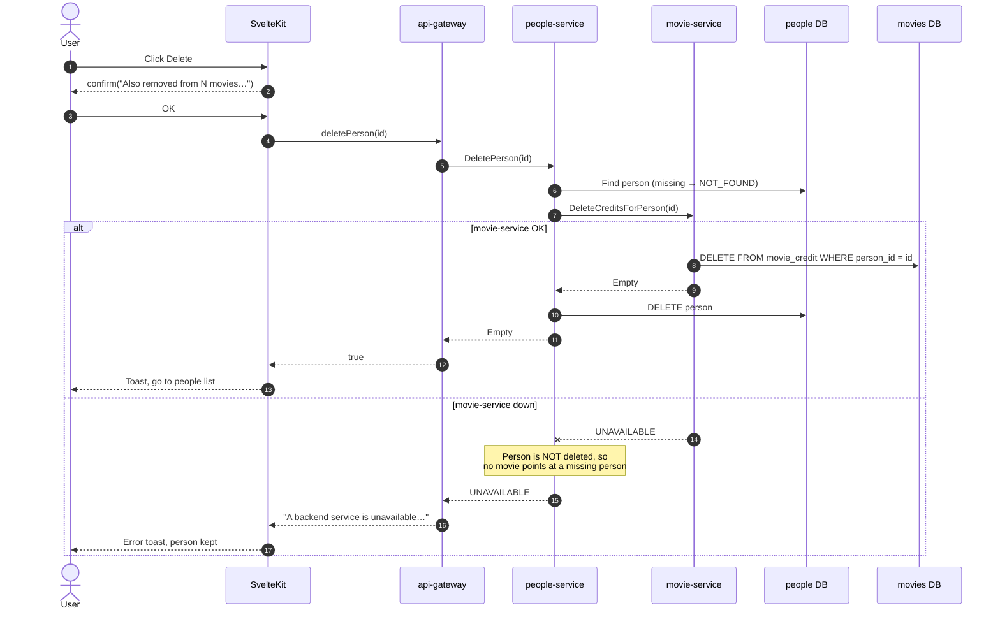

# Diagrams

GitHub renders these Mermaid diagrams automatically.

## 1. System flow

How a request travels through the system.

## 2. Request handling inside a service

Each backend layer has one job.

## 3. Sequence: list movies with cast (one batched people call)

## 4. Sequence: upload artwork with progress

## 5. Sequence: add a person to a movie (service-to-service gRPC)

## 6. Sequence: delete a person (keep data consistent across databases)

