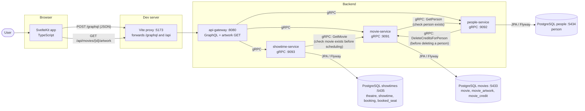
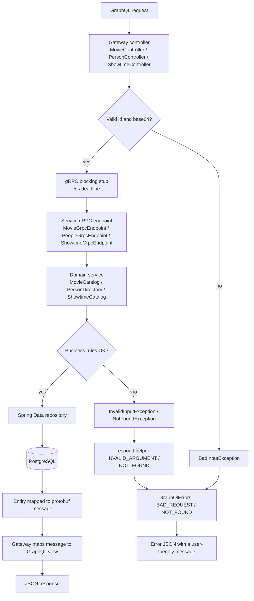
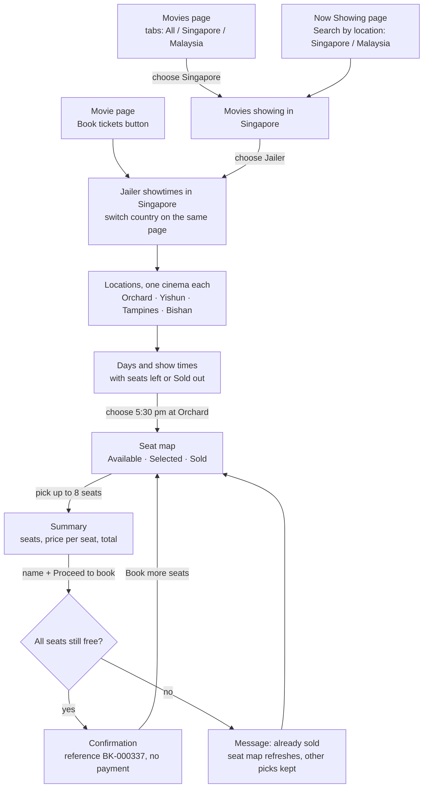
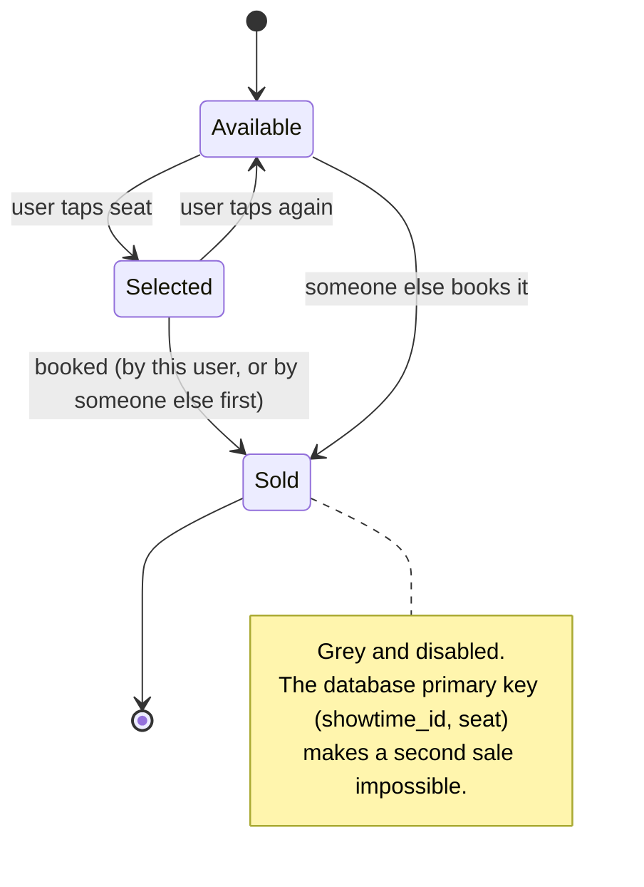
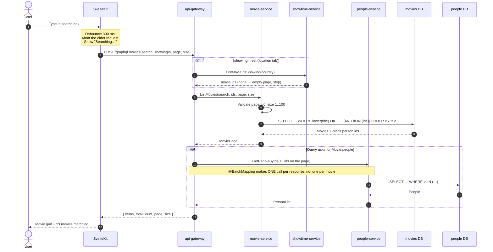
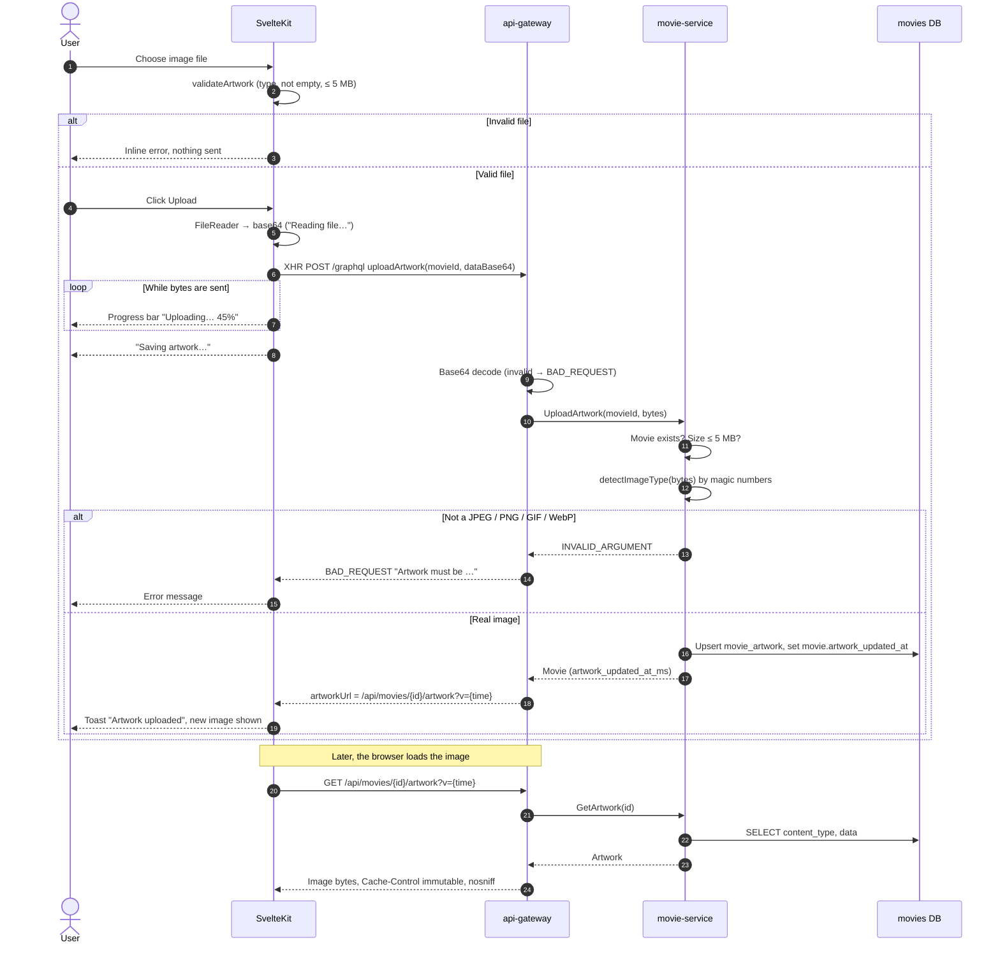
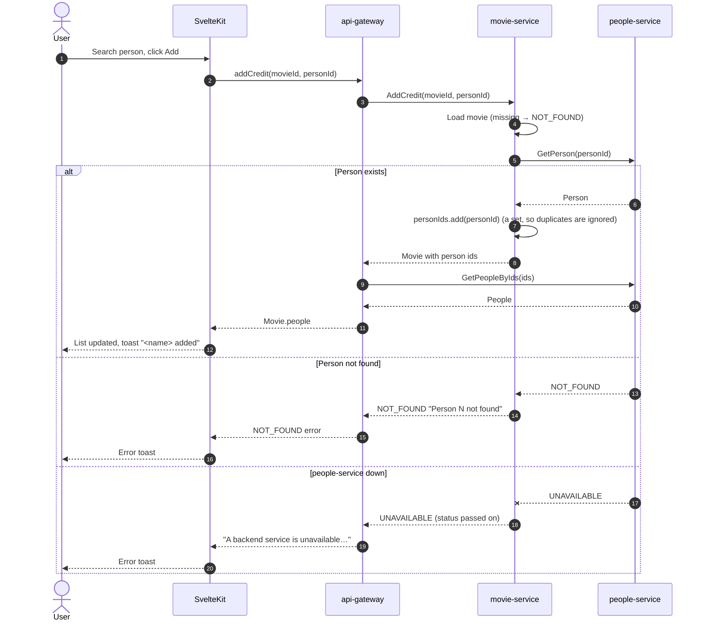
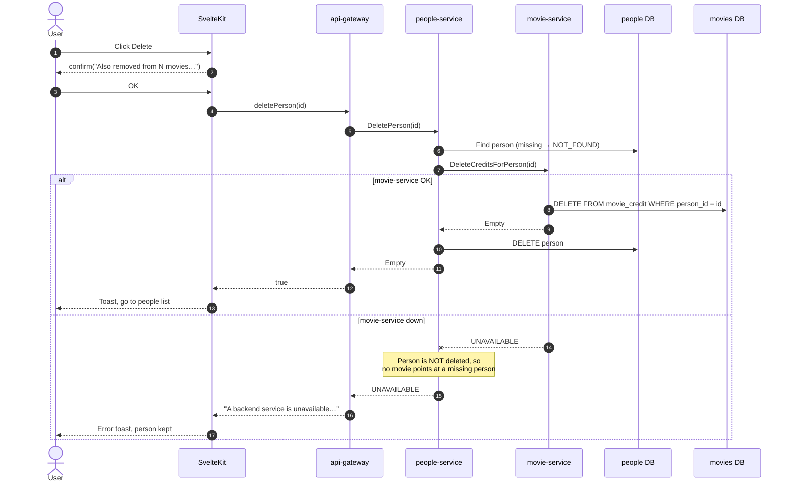
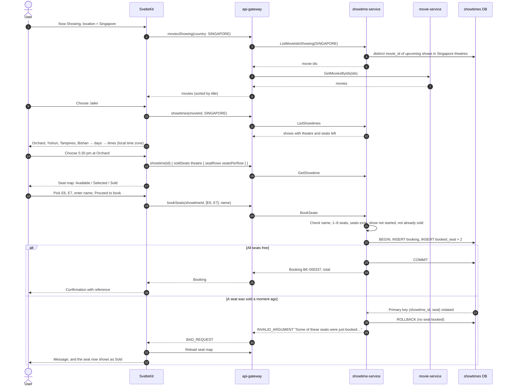

# Diagrams

GitHub renders these Mermaid diagrams automatically.

## 1. System flow

How a request travels through the system.

## 2. Request handling inside a service

Each backend layer has one job.

## 3. User journey: search by location and book seats

What the user sees, page by page.

## 4. Seat states on the seat map

## 5. Sequence: list movies with cast (one batched people call)

## 6. Sequence: upload artwork with progress

## 7. Sequence: add a person to a movie (service-to-service gRPC)

## 8. Sequence: delete a person (keep data consistent across databases)

## 9. Sequence: search by location and book seats

